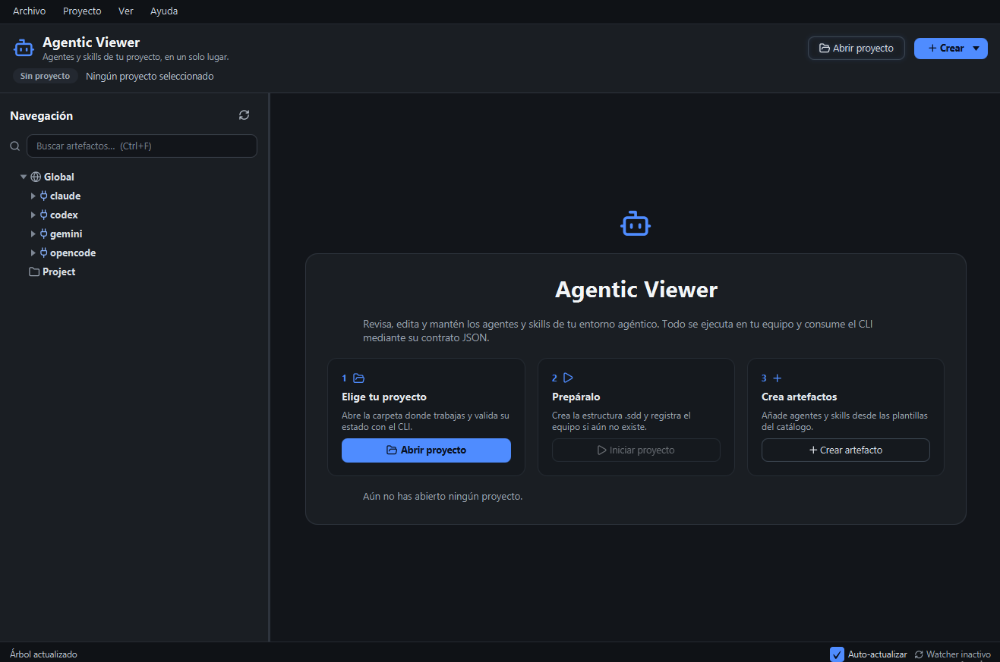

# Agentic Develop Kit v1.0

> Un entorno de desarrollo con agentes de IA que trabajan con especificaciones aprobadas por personas.

**Agentic Develop Kit** instala y mantiene los agentes y skills de Spec-Driven Development en
Claude, Codex, Gemini y OpenCode, prepara proyectos con la estructura `.sdd` y genera los agentes de
cada módulo y técnico. Incluye una herramienta de línea de comandos (CLI) y un visor de escritorio
para revisar, editar y mantener todo sin memorizar comandos.

Todo se ejecuta en tu equipo. No hay servicio remoto ni conexión a internet obligatoria.




## Índice

- [Qué es](#qué-es)
- [Qué problema resuelve](#qué-problema-resuelve)
- [Para quién es](#para-quién-es)
- [Qué puedes hacer hoy](#qué-puedes-hacer-hoy)
- [Cómo empezar](#cómo-empezar)
- [La ventana en un vistazo](#la-ventana-en-un-vistazo)
- [Atajos del visor](#atajos-del-visor)
- [Si prefieres la terminal](#si-prefieres-la-terminal)
- [Qué no es](#qué-no-es)
- [Cómo está organizado](#cómo-está-organizado)
- [Requisitos](#requisitos)
- [Documentación](#documentación)
- [Estado y colaboración](#estado-y-colaboración)

## Qué es

Es una herramienta para personas que trabajan con agentes de IA y quieren que esos agentes sigan un
método claro: primero se escriben y aprueban los requisitos, después el diseño y por último las
tareas. Solo entonces se implementa.

La aplicación se encarga de la parte repetitiva: instalar los agentes y skills en cada proveedor,
crear la estructura del proyecto, organizar los módulos y técnicos del equipo y mantener los
artefactos sincronizados cuando cambian.

## Qué problema resuelve

- **Cada proveedor guarda los agentes a su manera.** La aplicación conoce la estructura de Claude,
  Codex, Gemini y OpenCode y coloca cada cosa donde corresponde.
- **Los agentes se desactualizan.** Cuando cambias una convención compartida, la aplicación puede
  propagar el cambio al resto de copias del mismo grupo.
- **Es fácil perder de vista qué hay instalado.** El visor muestra un árbol con todo lo global, lo
  del proyecto y lo que pertenece a cada módulo.
- **Editar a mano es arriesgado.** Los cambios se guardan a través de la CLI, que detecta conflictos
  y pide confirmación antes de sobrescribir.
- **El método se olvida.** Los agentes y skills incluyen las reglas de Spec-Driven Development y el
  flujo de trabajo con aprobación humana entre fases.

## Para quién es

Para desarrolladores y equipos pequeños que ya usan o quieren usar agentes de IA para planificar e
implementar software, y que prefieren revisar y aprobar las especificaciones antes de que el agente
escriba código.

No hace falta saber programar la herramienta: el visor está pensado para trabajar con el ratón y con
atajos de teclado. La CLI queda disponible para quien prefiera la terminal o quiera automatizar.

## Qué puedes hacer hoy

### Preparar tu entorno

Instalar los agentes, skills y perfiles globales en los proveedores que uses. La aplicación no pisa
lo que ya existe sin permiso y guarda una copia del contenido anterior cuando sobrescribe.

### Preparar un proyecto

Abrir una carpeta, validar su estado y crear la estructura `.sdd` si todavía no existe. A partir de
ahí, el proyecto tiene su propio equipo, sus convenciones y su mapa de arquitectura.

### Organizar el equipo

Registrar módulos y asignarles técnicos (analista, desarrollador, documentador). Cada combinación
genera sus propios agentes y skills, con nombres consistentes y, cuando el proveedor lo permite,
perfiles de permisos.

### Crear y ajustar artefactos

Crear agentes y skills desde las plantillas del catálogo, revisar la plantilla antes de crearla y
personalizarla. También puedes editar la cabecera y el cuerpo de un agente, o los distintos ficheros
de una skill.

### Revisar y editar con seguridad

Ver el contenido de un agente, una skill o un fichero `.sdd` sin salir de la aplicación. Al guardar,
la CLI comprueba si el fichero cambió por fuera y evita pisar cambios ajenos. Si hay cambios sin
guardar, la aplicación te avisa antes de cambiar de artefacto o cerrar, y conserva una copia local
que se recupera al volver a abrir el artefacto.

### Mantener todo sincronizado

Propagar un cuerpo compartido al resto del grupo viendo antes las diferencias y los miembros
afectados. Volver a vincular un artefacto personalizado o desvinculado. La aplicación vigila los
cambios externos del proyecto y de los proveedores globales, y puede refrescar solo el árbol o
también el artefacto abierto.

### Trabajar desde la misma ventana

Buscar artefactos en el árbol, abrir una consola integrada con el CLI interactivo y cambiar entre la
vista del artefacto y la consola sin perder el contexto. La barra inferior indica el estado del
proyecto, los cambios sin guardar y si la vigilancia de ficheros está activa.

### Sin conexión

Todo funciona en local. No hay cuentas, telemetría ni servicios en la nube.

## Cómo empezar

### 1. Consigue la aplicación

Si ya tienes una **versión empaquetada**, ábrela: incluye su propio Java y el CLI que necesita el
visor, así que no tienes que instalar nada más. Salta al paso 2.

Si no la tienes, puedes generarla tú mismo o ejecutarla desde el código. Para eso necesitas JDK 21 y
Maven. Los comandos, las dependencias y el empaquetado están en la
[guía de desarrollo](docs/guia-desarrollo.md).

### 2. Configura al menos un proveedor

La primera vez necesitas instalar los agentes y skills globales en al menos un proveedor. El visor
trabaja con los proveedores que ya estén configurados; si no aparece ninguno, abre una terminal,
ejecuta el menú interactivo de la CLI y elige **Configuración entorno**. Los pasos y la ruta del CLI
en la versión empaquetada están en la
[guía de desarrollo](docs/guia-desarrollo.md#uso-de-la-cli).

### 3. Abre tu proyecto

Pulsa **Abrir proyecto** y elige la carpeta donde trabajas. La aplicación valida la carpeta con la
CLI y muestra su estado en la cabecera.

### 4. Prepara el proyecto

Si el proyecto todavía no tiene `.sdd`, aparecerá el botón **Iniciar proyecto**. Al pulsarlo se crea
la estructura de especificaciones y el proyecto queda listo para organizar el equipo.

### 5. Crea tu equipo

Abre **Crear → Módulo**, ponle un nombre y elige los técnicos y proveedores. La aplicación muestra
primero una simulación de lo que va a crear y solo escribe cuando confirmas.

Para añadir técnicos a un módulo que ya existe, usa **Crear → Añadir técnico**.

### 6. Crea agentes y skills

Usa **Crear → Artefacto**, elige proveedor, ámbito y tipo, selecciona un nombre del catálogo y revisa
la plantilla. Puedes editarla antes de crear el artefacto.

### 7. Revisa, edita y guarda

Selecciona cualquier agente, skill o fichero `.sdd` en el árbol. El panel central muestra su
contenido y, si es editable, permite cambiarlo. Usa **Guardar** o `Ctrl+S`; si el artefacto tiene un
cuerpo compartido, **Propagar** revisa antes las diferencias y los miembros afectados.

## La ventana en un vistazo

- **Menú superior:** abrir y recargar proyectos, crear artefactos, ajustes de vista y ayuda.
- **Barra lateral:** buscador, árbol de artefactos globales y del proyecto, avisos y resumen de la
  selección.
- **Zona central:** pestañas **Artefacto** y **Consola**. La vista de artefacto incluye metadatos,
  cabecera, cuerpo, ficheros de skill y acciones de guardado.
- **Barra inferior:** progreso, mensajes, cambios sin guardar, actualización automática y estado de
  la vigilancia de ficheros.

## Atajos del visor

| Atajo | Acción |
|---|---|
| `Ctrl+O` | Abrir proyecto |
| `F5` | Recargar el árbol |
| `Ctrl+S` | Guardar (en skills, todos los ficheros modificados) |
| `Ctrl+F` | Buscar artefactos |
| `Esc` | Limpiar la búsqueda |
| `F6` | Ir a la consola |
| `Ctrl+M` | Crear módulo |
| `Ctrl+Shift+T` | Añadir técnico |
| `Ctrl+N` | Crear artefacto |
| `Ctrl+Q` | Salir |

## Si prefieres la terminal

La CLI cubre el mismo flujo y devuelve JSON para poder integrarla en scripts:

```powershell
java -jar cli/target/agentic-develop.jar              # menú interactivo
java -jar cli/target/agentic-develop.jar status
java -jar cli/target/agentic-develop.jar init --project C:\mi-proyecto
```

La referencia completa de comandos, opciones, ejemplos y reglas de seguridad está en la
[guía de desarrollo](docs/guia-desarrollo.md). El contrato de datos está en
[docs/contracts/cli-json](docs/contracts/cli-json/cli-json.md).

## Qué no es

- **No escribe el código de tus proyectos.** Los agentes de Spec-Driven Development producen
  especificaciones; la implementación la haces tú o tus agentes de desarrollo.
- **No es un servicio remoto ni multiusuario.** Todo se ejecuta en tu equipo.
- **No gestiona los permisos de cada herramienta.** Esa configuración se hace manualmente en cada
  proveedor.

## Cómo está organizado

- **`cli/`**: la aplicación de línea de comandos. Hace el trabajo real sobre los ficheros y expone
  el resultado en JSON.
- **`viewer/`**: el visor de escritorio. Consume la CLI y ofrece árbol, previsualización, edición,
  consola y creación guiada.
- **`docs/contracts/`**: los contratos que describen el formato de los datos, las rutas y la
  organización del equipo.
- **`specs/`**: las especificaciones del propio proyecto (requisitos, diseño y tareas).
- **`scripts/`**: los scripts de empaquetado y verificación.

## Requisitos

- **Aplicación empaquetada:** ninguno. Incluye su propio runtime de Java.
- **Ejecutar desde el código:** JDK 21 y Maven 3.9 o superior.
- **Sistemas:** Windows y Linux.

## Documentación

- [Guía de desarrollo](docs/guia-desarrollo.md): compilar, probar, empaquetar y usar la CLI.
- [Especificación del visor](specs/viewer/): requisitos, diseño y tareas.
- [Especificación de la CLI](specs/cli/): requisitos, diseño y tareas.
- [Contratos](docs/contracts/): formato de datos, metadatos, rutas por proveedor y equipo.
- [Guía de pruebas en Linux/WSL](docs/guia-pruebas-linux-wsl.md).
- [Plan de release](docs/plan-release-1.0.md).
- [Licencia de los iconos (Lucide)](docs/third-party/lucide.txt).

## Estado y colaboración

El proyecto está en desarrollo activo. La CLI y el visor cubren el flujo descrito en este README; las
especificaciones y los contratos se actualizan junto con el código.

Si quieres proponer una mejora o reportar un problema, abre un issue o un pull request. Antes de
enviar un cambio, ejecuta las pruebas de la parte que hayas tocado:

```powershell
cd cli
mvn test

cd ../viewer
mvn test
```

Las decisiones de producto y de arquitectura se documentan en `specs/` y `docs/contracts/` para que
el cambio quede claro y revisable.
